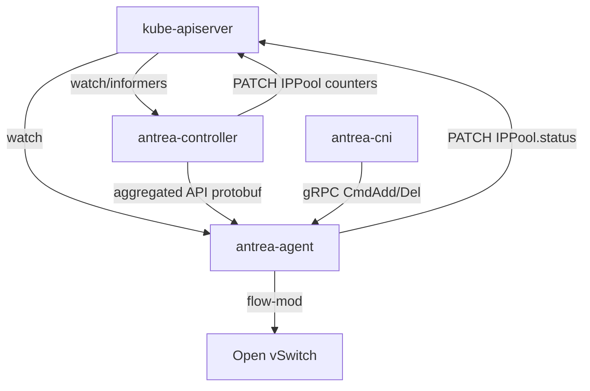

# Architecture and execution-path map

**Commit:** `3aca3e73e6d5461146b748eb7e5a31c4b7576ee3`  
**Primary references:** `docs/design/architecture.md`, `docs/antrea-ipam.md`, `docs/antrea-proxy.md`

## Repository layout (major packages)

| Area | Path | Role |
|---|---|---|
| Controller binary | `cmd/antrea-controller` | Watches K8s / Antrea CRDs; computes policy groups; IPPool usage |
| Agent binary | `cmd/antrea-agent` | OVS, CNI server, local policy install, proxy, IPAM |
| CNI plugin | `cmd/antrea-cni` | gRPC to Agent `CNIServer` |
| Network policy | `pkg/controller/networkpolicy`, `pkg/agent/controller/networkpolicy`, `pkg/agent/openflow` | Compute + dataplane |
| IPAM | `pkg/ipam/*`, `pkg/controller/ipam`, `pkg/agent/cniserver/ipam` | Pools, CNI allocation |
| Proxy | `pkg/agent/proxy` | Antrea Proxy (ClusterIP / NodePort) |
| Flow telemetry | `pkg/agent/flowexporter`, `pkg/flowaggregator` | IPFIX export + aggregation |
| Secondary network | `pkg/agent/secondarynetwork`, `pkg/agent/secondarynetwork/podwatch` | NAD-driven extra interfaces |
| Multicluster | `multicluster/` | Stretched policy, Gateway (separate binaries) |

## Component communication

## Execution paths (investigated)

### Path A — Primary Pod CNI ADD (AntreaIPAM)

1. `antrea-cni` → `pkg/agent/cniserver` `CmdAdd`.
2. `containerAccessArbitrator` lock for `(namespace, name, containerID)`.
3. `AntreaIPAM.Add` (`pkg/agent/cniserver/ipam/antrea_ipam.go`):
   - Resolve IPPool list (Pod annotation / default pool).
   - For each pool allocator: **one IPv4 and one IPv6 max** (`allocatedIPv4` / `continue` at 211–213).
   - `poolallocator.AllocateNext` → etcd `IPPool.status` via conflict-aware patch.
4. Configure interface + OVS port; on failure, defer runs `cmdDel` rollback.

**Invariant:** At most one allocated address per IP family per interface from the pool list (unless static request path).

### Path B — Secondary network CNI ADD

1. NAD `ipam.ippools` via secondary network controller.
2. `SecondaryNetworkAllocate` loops **every** listed pool (374–419) without `continue` after IPv4 success → **can append multiple IPv4 `result.IPs`**.
3. Same `poolallocator` and status patch semantics as primary.

**Invariant (documented / primary code):** One address per family; secondary path currently diverges.

### Path C — IPPool allocator initialization

1. Agent/controller construct `IPPoolAllocator`; `initIPAllocators` (`pkg/ipam/poolallocator/allocator.go` 121–154).
2. **CIDR** ranges: gateway (+ broadcast for full IPv4 /32 subnet) reserved before `NewCIDRAllocator`.
3. **Start/End** ranges: `NewIPRangeAllocator` with **no** gateway reservation (147–152).

**Invariant (`docs/antrea-ipam.md`):** Gateway is not a normal Pod address for either range type.

### Path D — NetworkPolicy

1. Controller watches NP + AntreaPolicy + Pods/NS/Groups → internal groups.
2. Serializes to Agents; agent reconciler programs OpenFlow.
3. HostNetwork Pods filtered at controller (`AddressGroupExcludedPodFilter`).

### Path E — Flow aggregator throughput

1. Agent flow exporter → aggregator gRPC.
2. `pkg/flowaggregator/aggregate.go`: inter-update duration and byte deltas; guarded against non-positive time window.

## Concurrency boundaries

- **Per-container CNI:** mutex in `cniserver` (not cross-Pod).
- **IPPool status:** `RetryOnConflict` in allocator; stale lister handling tested in `allocator_test.go`.
- **Policy:** per-node agent reconciler + OVS client (investigated at API level, not full OVS race audit).

## Testing infrastructure

| Layer | Location |
|---|---|
| Unit | `pkg/**/*_test.go` |
| Integration / e2e | `test/e2e`, `test/e2e-secondary-network` |
| Simulator | Agent simulator docs; No live cluster used for this audit |

## Gaps motivating findings

- No unit test that gateway ∉ start/end `AllocateNext` first result.
- No secondary-network test for multiple IPv4 pools in one NAD (`multiv4-1` exists only for primary `Add`).

See parent `../architecture.md` for the shorter Phase-1 diagram.