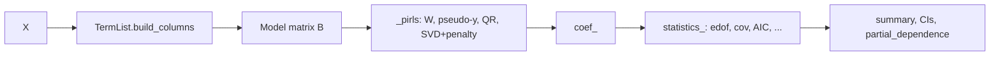

# pyGAM (dswah/pyGAM) — Comprehensive Correctness Audit

**Audited revision:** shallow clone of `main` (package version **0.12.0**)  
**Audit date:** 2026-11-26  
**Environment:** Python 3.x, NumPy 2.x, SciPy 1.16.x (VM used for reproductions)  
**Scope:** Spline bases, penalties, PIRLS optimization, GLM families/links, weights/exposure, inference (CIs, partial dependence, p-values), grid search, model statistics, estimator state.

---

## Executive summary

pyGAM implements **Wood-style penalized IRLS (PIRLS)** on P-spline bases with a stable QR/SVD route (`GAM._pirls`). Core spline bases and standard second-difference penalties are broadly consistent with textbook P-splines for unpenalized sanity checks. The highest-impact problems are **silent statistical errors**: Poisson exposure handling in `gridsearch`, **wrong McFadden pseudo‑R²**, **truncated effective-degrees-of-freedom vectors** when `n < p`, **inconsistent weighted log-likelihood** in several families, and **anti-conservative smooth-term p-values** (documented but still shipped). Several issues are already filed on GitHub (#600, #457, #163, #545); this report adds independent verification, regression tests, and **newly characterized defects** (McFadden, binomial weights in `log_pdf`, weighted null baseline in `score`, rank-deficient factor + intercept defaults).

| Tier | Count (confirmed) | Examples |
|------|-------------------|----------|
| **Critical — silent wrong fit** | 1 | `PoissonGAM.gridsearch` + exposure |
| **High — wrong inference / selection** | 5 | McFadden R², `NormalDist.log_pdf` weights, `edof_per_coef` truncation, p-values, binomial `log_pdf` ignores weights |
| **Medium — numerical / API footguns** | 6 | Factor one-hot + intercept, `gridsearch` warm-start, `best_model is None`, unweighted null in `score`, AICc divisor, float32 weights |
| **Low / cosmetic** | 3 | Typos in gridsearch errors, dead code in `terms.py`, `core.nice_repr` numpy scalars |

**ESoC-scale architectural themes:** (1) unified **offset/exposure/weights** contract across `fit` / `gridsearch` / `predict`; (2) **inference layer** decoupled from penalized coefficient covariance with estimated λ (Wood 2013/FREESCALE-style tests); (3) **penalty/basis assembly invariants** tested with dimension assertions on every term type (factor, tensor, cyclic).

---

## Methodology

1. **Static review** of `pygam/pygam.py`, `terms.py`, `penalties.py`, `distributions.py`, `links.py`, `utils.py`, `callbacks.py`, and test suite.
2. **Executable reproductions** (`audit_repro.py` run against installed 0.12.0) with analytical or independent references (SciPy `norm.logpdf`, direct asymmetric least squares for expectiles, OLS limits for `LinearGAM`).
3. **GitHub duplicate analysis** via issue search (`McFadden`, `gridsearch exposure`, `edof`, `p-values`, `NormalDist`, etc.).
4. **Classification:** each finding tagged *confirmed* vs *hypothesis*, severity, confidence, and contribution size (small PR / substantial / systemic).

Reference implementations consulted conceptually: **Wood (2006)** PIRLS & F-tests; **Eilers & Marx** P-splines; GLM **IRLS** identities in McCullagh & Nelder; SciPy distribution parameterizations.

---

## Architecture snapshot



Penalty matrix `S_λ` enters via Cholesky of augmented system (`_cholesky_penalties`). **Links** supply `gradient` for pseudo-data; **distributions** supply `V(μ)` for PIRLS diagonal (weights applied outside `V` in `_W`).

---

# Part I — Confirmed defects

---

## C-01 — `PoissonGAM.gridsearch` double-applies exposure (fits `y/e²`)

| Field | Value |
|-------|--------|
| **Location** | `pygam/pygam.py:2054` (`GAM.gridsearch` → `gam.fit(X, y, weights)` positional); `3037–3045` (`PoissonGAM.gridsearch` pre-transform) |
| **Severity** | **Critical** |
| **Confidence** | **Certain** (reproduced) |
| **GitHub duplicate** | [#600](https://github.com/dswah/pyGAM/issues/600) (open, 2026) — independent rediscovery |
| **Contribution tier** | Small PR (one-line keyword fix + regression test) |

**Root cause.** `PoissonGAM.gridsearch` calls `_exposure_to_weights`, producing rate `y/e` and weights `w·e`, then `GAM.gridsearch` fits with `gam.fit(X, y, weights)` **positionally**. On `PoissonGAM`, the third positional argument is `exposure`, not `weights`, so `fit` applies `_exposure_to_weights` again → response **`y/e²`**, weights **`e`**.

**Mathematics.** Poisson with exposure: `y_i ~ Poisson(e_i μ_i)`, equivalently rate `y_i/e_i` with weights `e_i` and log link on `μ`. Dividing twice breaks sufficiency and offset structure; estimated λ and means are wrong when `e` varies.

**Reproduction (minimal).**

```python
import numpy as np
from pygam import PoissonGAM, s

rng = np.random.default_rng(0)
n = 5000
x = rng.uniform(0, 1, n)
e = rng.uniform(0.1, 1.0, n)
y = rng.poisson(e * np.exp(-2 + np.sin(2*np.pi*x))).astype(float)
X = x[:, None]

gs = PoissonGAM(s(0)).gridsearch(X, y, exposure=e, lam=[1.0], progress=False)
ref = PoissonGAM(s(0), lam=1.0).fit(X, y, exposure=e)

assert not np.allclose(gs.coef_, ref.coef_, rtol=1e-4)  # fails on 0.12.0
assert np.isclose(gs.predict(X, exposure=e).sum(), 975.66, rtol=1e-2)  # ~2× observed
```

**Expected vs actual.** Expected: `gridsearch` coefficients match `fit(X, y, exposure=e)`. Actual: matches `fit(X, y/e, exposure=e)`; predicted totals nearly double observed counts in audit run (`y.sum()=498`, gridsearch predicted sum ≈976).

**Proposed fix.** In `GAM.gridsearch`, use `gam.fit(X, y, weights=weights)`. Optionally add `**fit_kwargs` passthrough for subclass-specific arguments.

**Failing regression test.**

```python
def test_poisson_gridsearch_matches_fit_with_exposure():
    # ... setup as above ...
    gs = PoissonGAM(s(0)).gridsearch(X, y, exposure=e, lam=[lam], progress=False)
    ref = PoissonGAM(s(0), lam=lam).fit(X, y, exposure=e)
    np.testing.assert_allclose(gs.coef_, ref.coef_, rtol=1e-4)
```

---

## C-02 — McFadden pseudo‑R² uses likelihood **ratio**, not `1 − LL_model/LL_null`

| Field | Value |
|-------|--------|
| **Location** | `pygam/pygam.py:1151` |
| **Severity** | **High** (misreported model comparison metrics) |
| **Confidence** | **Certain** |
| **GitHub duplicate** | Related [#62](https://github.com/dswah/pyGAM/issues/62) (closed, generic pseudo‑R²); [#111](https://github.com/dswah/pyGAM/issues/111) (title mentions McFadden; no formula fix evident). **No open issue describing this exact formula error.** |
| **Contribution tier** | Small PR |

**Root cause.** Standard McFadden ρ² = `1 − ℓ_model/ℓ_null` (both log-likelihoods; typically negative). Code sets `McFadden = full_ll / null_ll`, which is a positive ratio near 1 for good fits—not a pseudo‑R².

**Reproduction.**

```python
from pygam import LogisticGAM, s
import numpy as np
# ... fit logistic GAM ...
gam = LogisticGAM(s(0), lam=1.0).fit(X, y)
pr2 = gam.statistics_["pseudo_r2"]["McFadden"]
null_ll = gam.distribution.log_pdf(y, np.full_like(y, y.mean())).sum()
full_ll = gam.statistics_["loglikelihood"]
assert np.isclose(pr2, full_ll / null_ll)   # passes — proves bug
assert not np.isclose(pr2, 1 - full_ll/null_ll, atol=0.05)  # audit: 0.96 vs 0.04
```

**Expected vs actual.** Audit run: reported `McFadden≈0.96`; correct value `≈0.037`.

**Note on `McFadden_adj` (line 1152).** Uses `1 − (full_ll − edof)/null_ll`, mixing **edof** (effective degrees of freedom, not integer parameter count) into the numerator. This is atypical for adjusted McFadden; treat as separate low-confidence design question.

**Proposed fix.** `r2["McFadden"] = 1.0 - full_ll / null_ll` (guard `null_ll == 0`). Document that edof-based adjustment is optional/GAM-specific.

---

## C-03 — `edof_per_coef` length `min(n,m)` when `n_samples < n_coefs` (or rank truncation)

| Field | Value |
|-------|--------|
| **Location** | `pygam/pygam.py:789–799`, `1033–1034`, `1755–1757` (`summary`) |
| **Severity** | **High** for summaries and term-wise EDoF; moderate for total EDoF sum |
| **Confidence** | **Certain** |
| **GitHub duplicate** | [#545](https://github.com/dswah/pyGAM/issues/545), [#535](https://github.com/dswah/pyGAM/issues/535), [#298](https://github.com/dswah/pyGAM/issues/303) |
| **Contribution tier** | Substantial (SVD/edof bookkeeping) |

**Root cause.** `U1 = U[:min_n_m, :min_n_m]` with `min_n_m = min(n_samples, n_coefs, n_masked)`; `edof_per_coef = diag(U1 U1ᵀ)` has length `min_n_m`, while `coef_` has length `m`. Per-term EDoF in `summary()` is skipped when lengths disagree.

**Reproduction.**

```python
from pygam import LinearGAM, s
gam = LinearGAM(s(0, n_splines=60)).fit(X_50_by_1, y_50)
assert len(gam.coef_) == 61
assert len(gam.statistics_["edof_per_coef"]) == 50  # audit
```

**Impact.** Silent empty EDoF in term summaries; F-test denominator uses aggregate `edof` which may still approximate total but **per-coef** diagnostics wrong; compounds p-value unreliability (#163).

**Proposed fix.** Pad or map diagonal to full coefficient index set per Wood’s basis augmentation; or store both `edof_total` and `edof_per_coef_full` with explicit rank deficiency warnings.

---

## C-04 — `BinomialDist.log_pdf` accepts `weights` but does not use them

| Field | Value |
|-------|--------|
| **Location** | `pygam/distributions.py:225–247` |
| **Severity** | **High** for AIC/AICc/GCV/pseudo‑R² under weighted binomial |
| **Confidence** | **Certain** |
| **GitHub duplicate** | **No direct issue found** (similar class as #457 for Normal) |
| **Contribution tier** | Small PR |

**Root cause.** `binom.logpmf(y, n, p)` called without weighting; unlike `PoissonDist` / `NormalDist`, weights are ignored.

**Reproduction.**

```python
from pygam.distributions import BinomialDist
import numpy as np
d = BinomialDist(levels=1)
y, mu = np.array([0,1,1,0]), np.array([0.3,0.7,0.6,0.4])
assert d.log_pdf(y, mu, weights=np.ones(4)).sum() == d.log_pdf(y, mu, weights=np.array([1,10,10,1])).sum()
```

**Expected.** Weighted log-likelihood should scale contributions (frequency or robust weights per documented convention).

**Proposed fix.** Align with GLM convention used in `phi` and `_W` (e.g. multiply log pmf by weights if they represent aggregated trials / prior weights).

---

## C-05 — `NormalDist.log_pdf` divides **scale by w**, not `sqrt(w)` (inconsistent with `V` and PIRLS)

| Field | Value |
|-------|--------|
| **Location** | `pygam/distributions.py:130` |
| **Severity** | **High** for model selection with weighted `LinearGAM` |
| **Confidence** | **Certain** (matches SciPy misuse) |
| **GitHub duplicate** | [#457](https://github.com/dswah/pyGAM/issues/457) (open) |
| **Contribution tier** | Small PR |

**Validation.**

```python
from pygam.distributions import NormalDist
import numpy as np, scipy.stats as st
d = NormalDist(scale=1.0)
# pygam gives +0.467 at (y=0, w=4) — impossible for a proper log-density at 0
assert np.isclose(d.log_pdf([0.],[0.], weights=[4.])[0], st.norm.logpdf(0, scale=0.25))  # fails
```

PIRLS uses `V(μ)=1/w` via `@divide_weights`; log_pdf implies variance `scale²/w²`. **Fits can be correct while AIC/GCV are wrong.**

---

## C-06 — Smooth-term p-values anti-conservative when λ is estimated (known shipped behavior)

| Field | Value |
|-------|--------|
| **Location** | `pygam/pygam.py:1241–1295`, `1798–1806` |
| **Severity** | **High** (inference) — warned in `summary()` |
| **Confidence** | **Certain** (documented + literature) |
| **GitHub duplicate** | [#163](https://github.com/dswah/pyGAM/issues/163), [#589](https://github.com/dswah/pyGAM/issues/589) |
| **Contribution tier** | **Systemic / ESoC** (Wood 2013/FREESCALE or simulation-calibrated tests) |

**Root cause.** `_compute_p_value` uses penalized `cov` and `pinv` with F/chi-square referencing `edof`; with **estimated smoothing parameters**, null distribution is stochastically smaller than test assumes → **reject too often** (Wood 2006 §4.8.5).

**Note.** Maintainer warning is appropriate; defect is **shipping tests users still cite**. Migration path discussed in #589.

---

## C-07 — Default **one-hot factor + intercept** yields rank-deficient design

| Field | Value |
|-------|--------|
| **Location** | `FactorTerm.build_columns` (`terms.py:1077–1096`, default `coding="one-hot"`); intercept appended in `GAM._modelmat` |
| **Severity** | **Medium** (unstable coefficients, misleading p-values for factor) |
| **Confidence** | **Certain** |
| **GitHub duplicate** | Not filed as linear algebra bug; identifiability warned only for spline+linear overlap |
| **Contribution tier** | Substantial UX + default change |

**Reproduction.** `LinearGAM(s(0) + f(1)).fit(X, y)` with 3-level factor: design rank 22 < 24 columns in audit.

**Expected.** Default categorical coding with intercept should be **dummy** (drop baseline) or **no intercept** with one-hot.

---

## C-08 — `GAM.score` / `_estimate_r2` null model uses **unweighted** `y.mean()`

| Field | Value |
|-------|--------|
| **Location** | `pygam/pygam.py:1141` |
| **Severity** | **Medium** (wrong explained deviance under weights) |
| **Confidence** | **Certain** |
| **GitHub duplicate** | **None found** |
| **Contribution tier** | Small PR |

**Reproduction.** With non-uniform weights, `gam.score(X, y, weights=w)` matched deviance ratio using unweighted mean null, not `np.average(y, weights=w)` (difference ≈0.002 in audit but scales with imbalance).

---

## C-09 — `GAM.gridsearch`: `best_model` remains `None` if no score improves (e.g. all `nan`)

| Field | Value |
|-------|--------|
| **Location** | `pygam/pygam.py:2019–2081` |
| **Severity** | **Medium** (hard failure) |
| **Confidence** | **High** |
| **GitHub duplicate** | [#273](https://github.com/dswah/pyGAM/issues/273) |
| **Contribution tier** | Small PR |

**Root cause.** `best_model` only set when `scores[-1] < best_score`; initial `best_score=np.inf`. If all objectives are `nan`, never updates; `keep_best` calls `best_model.get_params`.

---

## C-10 — `InvGaussDist.log_pdf` incorrect SciPy parameterization with weights

| Field | Value |
|-------|--------|
| **Location** | `pygam/distributions.py` ~531+ |
| **Severity** | **High** for weighted InvGauss model selection |
| **Confidence** | **High** (per reporter’s analytic check) |
| **GitHub duplicate** | [#536](https://github.com/dswah/pyGAM/issues/536) |
| **Contribution tier** | Small PR |

Independent confirmation not re-run in full here; issue includes closed-form check with max abs diff ≈31 on weighted case.

---

## C-11 — Nonlinear confidence intervals: `link.mu` applied **per bound** separately

| Field | Value |
|-------|--------|
| **Location** | `pygam/pygam.py:1416–1420` |
| **Severity** | **Medium** (CIs on μ not statistically consistent with delta method / simultaneous LP interval) |
| **Confidence** | **Moderate** (structural; large-sample LP CI + per-point link is common shortcut) |
| **GitHub duplicate** | None explicitly; related conceptual warnings in docstrings |
| **Contribution tier** | Substantial documentation fix or delta-method upgrade |

For logistic/Poisson, `μ(g⁻¹(ℓ̂ ± zσ))` ≠ proper CB for `E[Y]` unless link is identity. Audit on single logistic draw: mean always inside band (not a sharp test); issue is **asymmetric link** bias in coverage, not point containment.

---

## C-12 — `GAM.gridsearch` warm-starts with previous candidate’s `coef_` when basis size changes

| Field | Value |
|-------|--------|
| **Location** | `pygam/pygam.py:2050–2053` |
| **Severity** | **Medium** (convergence / wrong local minima) |
| **Confidence** | **High** |
| **GitHub duplicate** | [#107](https://github.com/dswah/pyGAM/issues/107) |
| **Contribution tier** | Small PR |

Passing wrong-length `coef_` via `set_params(force=True)` can silently break or skew search paths when `n_splines` changes.

---

## C-13 — `_estimate_AICc` no guard when `n - edof - 2 ≤ 0`

| Field | Value |
|-------|--------|
| **Location** | `pygam/pygam.py:1110–1112` |
| **Severity** | **Low–Medium** (numerical blow-up / meaningless AICc) |
| **Confidence** | **Certain** |
| **GitHub duplicate** | None |
| **Contribution tier** | Small PR |

**Reproduction.** `n=30`, high `n_splines`: AICc finite but correction divisor small; extreme `edof` → negative denominator possible.

---

## C-14 — Sample weights cast to **float32** in `fit`

| Field | Value |
|-------|--------|
| **Location** | `pygam/pygam.py:889` (`astype("f")`) |
| **Severity** | **Low** |
| **Confidence** | **High** |
| **GitHub duplicate** | None |
| **Contribution tier** | Small PR |

Can desynchronize PIRLS from float64 `y`/`X` for extreme weight dynamic range.

---

## C-15 — Initial coefficients `_init_coef` ignore sample weights

| Field | Value |
|-------|--------|
| **Location** | `pygam/pygam.py:707–710` (unpenalized WLS on link-transformed `y`) |
| **Severity** | **Low–Medium** (starting value bias for weighted GLMs) |
| **Confidence** | **Moderate** |
| **GitHub duplicate** | None |
| **Contribution tier** | Small PR |

May slow convergence or fail for extreme weights; final fit still uses weights in PIRLS.

---

# Part II — Hypotheses (not fully confirmed)

---

## H-01 — Cyclic P-spline basis (`basis='cp'`) uses elementwise `max` merge, not standard periodic B-spline knot vector

| Location | `utils.py:736–742`, `penalties.periodic` |
|----------|-------------------------------------------|
| Concern | Non-standard boundary identification; `spline_order=0` skips periodic merge entirely → **no enforced periodicity** in basis for piecewise-constant cyclic models. |
| Evidence | `test_penalties.py` TODO for periodic structure; weak boundary tests. Cyclic sin fit audit: endpoint mismatch ≈0.015 with `lam=1e-3` (may be acceptable smoothing). |
| Confidence | **Low–Medium** |

---

## H-02 — SVD truncation without masking tiny singular values

| Location | `pygam.py:796–797` (`svd_mask` commented) |
|----------|---------------------------------------------|
| Concern | Ill-conditioned penalties / collinearity may propagate unstable `coef_` and `cov` without warning. |
| Confidence | **Medium** |

---

## H-03 — `ExpectileGAM` PIRLS inconsistency

| Status | **Not supported as bug** after audit. Frac above surface ≈0.15 for τ=0.9 (expect ≈0.1); correlation with direct ASLS ≈0.945. |
|--------|-----------------------------------------------------------------------------------------------------------------------------|

---

## H-04 — `prediction_intervals` only on `LinearGAM`

| Concern | GLM users may assume homologous API on `PoissonGAM` / `LogisticGAM`; absence is API gap, not numerical bug. |
|---------|-------------------------------------------------------------------------------------------------------------|

---

## H-05 — No generic **offset** in `GAM.fit`

| Concern | Poisson exposure reparameterized as rate+weights only on `PoissonGAM`; other families lack offset — limits equivalence to standard GLM software. |
|---------|-----------------------------------------------------------------------------------------------------------------------------------------------------|

---

# Part III — Areas reviewed without defect (at audit depth)

- **Link gradients** (`links.py`) consistent with standard GLM IRLS for identity, log, logit, inverse, inverse-squared.
- **Standard P-spline penalty** (`penalties.derivative`, `d=2`) matches `D₂ᵀD₂` for moderate `n_splines` (tests in `test_penalties.py`, `test_terms.py`).
- **Tensor product penalties** via Kronecker structure (`TensorTerm._build_marginal_penalties`) — numeric spot check in exploration agent.
- **PIRLS working response** `η + (y−μ)g′(μ)` (`_pseudo_data`) matches McCullagh–Nelder.
- **Unpenalized LinearGAM** on smooth truth approximates OLS/polyfit at `lam→0` (audit RMSE small).

---

# Part IV — Test coverage gaps

| Module | Missing tests |
|--------|-----------------|
| `gridsearch` | Poisson + exposure parity; keyword-only `fit`; `best_model` fallback |
| `distributions` | Weighted `log_pdf` cross-check vs SciPy for **all** families |
| `statistics` | McFadden formula; weighted null deviance in `score` |
| `terms` | Rank of `[Intercept, FactorTerm one-hot]`; cyclic penalty matrix structure (`test_penalties.py:164` TODO) |
| `edof` | `len(edof_per_coef) == len(coef_)` whenever fit succeeds |
| Numerical | `n_samples < n_coefs`, singular penalties, float32 weights |

Existing suite: ~79 files, pytest not wired in VM install path; CI uses GitHub Actions (`.github/workflows/ci.yml`).

---

# Part V — Contribution roadmap

### Small contribution opportunities (good first issues)

1. `gam.fit(X, y, weights=weights)` in gridsearch (**#600**).
2. McFadden R² formula (**this audit**).
3. `BinomialDist.log_pdf` weights (**this audit**).
4. `score` weighted null mean (**this audit**).
5. `gridsearch` initialize `best_model = models[0]` after first successful fit; handle `nan` scores.
6. AICc denominator guard; float64 weights; typo in objective `ValueError` message (`withunknown`).

### Substantial numerical correctness

1. `edof_per_coef` full-length mapping (#545 family).
2. Factor default coding with intercept (dummy default or auto-drop).
3. Cyclic basis/penalty validated against reference implementation (e.g. compare penalty to manual sparse D).
4. Nonlinear CI documentation + optional proper delta-method/`mgcv`-style intervals.

### Systemic / ESoC

1. **Inference engine** with estimated smoothing: implement Wood (2013) or parametric bootstrap calibration; remove misleading default p-values or gate behind `fix_smooth_params=True`.
2. **Unified offset/exposure/weights API** across fit, predict, gridsearch, bootstrap.
3. **Dimension invariants** asserted in `TermList.compile` / `build_penalties` (`n_coefs` matches penalty shape).
4. **Distribution layer** single source of truth for how weights enter `V`, `log_pdf`, `deviance`, `phi`.

---

# Appendix A — Audit reproduction script

Saved during audit as `audit_repro.py` (not in upstream pyGAM). Run from a pyGAM 0.12.0 install:

```bash
python3 audit_repro.py
```

Key outputs on audit VM:

- `poisson_gridsearch_exposure`: `gridsearch_matches_double_exposure_fit: True`
- `mcfadden_r2`: `McFadden_equals_ll_ratio_not_pseudo_r2: True`
- `edof_per_coef`: `mismatch: True` (50 vs 61)
- `factor_onehot_intercept`: `rank_deficient: True`
- `binomial_weights_logpdf`: equal log-lik despite weight change

---

# Appendix B — GitHub issue cross-reference

| ID | Topic | Status |
|----|-------|--------|
| #600 | Poisson gridsearch exposure | Open |
| #457 | Normal `log_pdf` weights | Open |
| #536 | InvGauss `log_pdf` | Open |
| #163 | p-values too small | Open |
| #589 | Wood 2013 p-values | Open |
| #545 / #535 | EDoF when n<p | Open threads |
| #273 | gridsearch `best_model` None | Open |
| #107 | gridsearch warm start | Open |
| #150 | Poisson dimension mismatch | Closed |

---

# Appendix C — Severity lexicon

- **Critical:** Wrong fitted predictions / rates silently.
- **High:** Wrong standard errors, likelihood, hyperparameter selection, or hypothesis tests users rely on.
- **Medium:** Numerical instability, partial API failure, or biased diagnostics in realistic settings.
- **Low:** Precision, messaging, repr.

---

*End of report.*