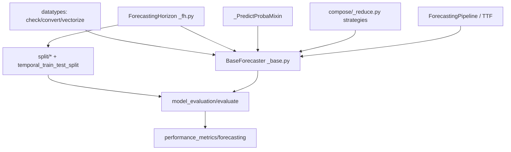

# sktime architecture map (correctness audit)

**Upstream:** [sktime/sktime](https://github.com/sktime/sktime)  
**Revision audited:** `c2be801ec7c3183457c2ec9bd7109266a41d9e35` (2026-03-27)

## Executive summary

sktime layers **datatypes** → **base forecasting** (`BaseForecaster`, `ForecastingHorizon`) → **composition** (reduction, pipelines, multiplex) → **evaluation** (splitters, `evaluate`, metrics). Correctness risk concentrates in shared infrastructure, not individual naive baselines.

## Layer diagram

## Complexity & centrality ranking

| Rank | Module | Path (approx) | Why it matters | Test gap signal |
|------|--------|---------------|----------------|-----------------|
| 1 | ForecastingHorizon | `forecasting/base/_fh.py` (~1k LOC) | Every forecaster, split, metric | Strong unit tests; edge cases remain (irregular index, int `fh`) |
| 2 | Reduction | `forecasting/compose/_reduce.py` (~3.4k) | Recursive/direct/dirrec, exog padding | Heavy compose tests; **global RRF `tests:skip_all` (#7380)** |
| 3 | Base forecaster | `forecasting/base/_base.py` (~2.7k) | fit/predict/update, vectorization, fh checks | `test_all_forecasters`, `test_base_bugs` |
| 4 | Datatypes | `datatypes/_check.py`, `_vectorize.py` | Panel/hier boundaries, coercion | Thin per-path coverage |
| 5 | Pipelines | `forecasting/compose/_pipeline.py` | Transformer boundaries, synthetic `y` | Many regression tests (#5518, #8455) |
| 6 | Probabilistic defaults | `base/_proba/_mixin.py` | interval↔quantile↔var | Multivariate quantile regression added |
| 7 | Split / CV | `split/fh.py`, `split/base/*` | Leakage semantics, int `fh` | `test_fh.py` light on boundary cases |
| 8 | Evaluate | `model_evaluation/_functions.py` | `cv_global` temporal leakage | Documented; no hard guard |
| 9 | Metrics | `performance_metrics/forecasting/_functions.py` | Hierarchical alignment | Many metric modules lack dedicated tests |
| 10 | Adapters | `forecasting/base/adapters/*` | `to_indexer(from_cutoff=…)` semantics | pmdarima/statsforecast diverge |

## Investigation order used

1. `ForecastingHorizon` + `check_fh` integer coercion (`n` → `1…n`).
2. Recursive reduction numpy path (exogenous window assembly).
3. `ForecastingHorizonSplitter` / `temporal_train_test_split`.
4. Irregular `DatetimeIndex` + relative `fh`.
5. Probabilistic mixin chain (known multivariate fix in `test_base_bugs.py`).
6. Tag-skip estimators (`tests:skip_all`).

## Small-contribution entry points

- Add validation/tests around `_reduce.py` `np.pad(..., "edge")` when `len(X) < window + fh_max`.
- Splitter: reject `len(train)==0` or `fh` int where `max(fh) >= len(y)`.
- `_to_absolute`: actionable error when `fh.freq is None` on irregular datetime cutoff.
- Regression tests for `FhPlexForecaster` + `fh_contiguous` metric pollution (documented CAUTION).

## Multi-week (ESoC-scale) themes

1. **Horizon contract** — unify int/fh list semantics, timedelta horizons, `to_indexer` for all index types, freq inference for irregular series.
2. **Recursive exogenous futures** — explicit API for known vs unknown `X`; align recursive/direct/multioutput validation.
3. **Temporal evaluation safety** — fail-fast splitters, optional `cv_global_temporal` default, audit `TestPlusTrainSplitter` + negative relative `fh`.
4. **Probabilistic forecasting compliance** — hierarchical/panel `predict_proba` reduction sampling; expand CI for `tests:skip_all` forecasters.
5. **Estimator compliance harness** — extend `test_all_forecasters` with fh irregularity, short `X`, clone/reset after `update`.