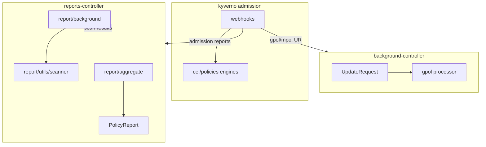

# Kyverno architecture map (kyverno/kyverno)

Reference checkout: shallow clone of `github.com/kyverno/kyverno` `main` (CEL-era, post-#17710 legacy engine removal). Authoritative overview: upstream `ARCHITECTURE.md`.

## Runtime binaries (`cmd/`)

| Binary | Path | Role |
|--------|------|------|
| `kyverno` | `cmd/kyverno/` | Admission webhook server; CEL engines (vpol, mpol, gpol, ivpol); policy/webhook/cert controllers |
| `kyvernopre` | `cmd/kyverno-init/` | Pre-start webhook and legacy cleanup |
| `background-controller` | `cmd/background-controller/` | `UpdateRequest` processing: gpol generate, mpol mutate-existing |
| `cleanup-controller` | `cmd/cleanup-controller/` | CleanupPolicy + DeletingPolicy (dpol) CEL engine |
| `reports-controller` | `cmd/reports-controller/` | Admission + background scan reports → PolicyReport aggregation |
| `kubectl-kyverno` | `cmd/cli/kubectl-kyverno/` | Offline apply/test |
| `readiness-checker` | `cmd/readiness-checker/` | Probe helpers |

Shared bootstrap: `cmd/internal/` (kubeconfig, clients, informers, metrics).

## Policy evaluation (CEL-first)

```
pkg/cel/
├── compiler/          # Match conditions, variables, exceptions, HTTP, cost
├── engine/            # Request/response, exception scoping
├── libs/              # object, request, variables, imageverify bindings
├── matching/          # Resource/namespace/object selectors (K8s admission alignment)
├── autogen/           # Pod-controller rule replication + exception rewrite
└── policies/
    ├── vpol/          # ValidatingPolicy
    ├── mpol/          # MutatingPolicy (+ JSON patch compiler)
    ├── gpol/          # GeneratingPolicy
    ├── dpol/          # DeletingPolicy
    └── ivpol/         # ImageValidatingPolicy
```

**Legacy `pkg/engine/`:** JMESPath, apicall context, strategic merge patches, shared `engineapi` types — consumed by CEL paths and CLI, not a standalone admission loop.

**External API types:** `github.com/kyverno/api` — `policies.kyverno.io` (VPol, MPol, GPol, DPol, IVPol, PolicyException). In-repo CRD YAML under `config/crds/policies.kyverno.io/`.

## Admission path

```
HTTP → pkg/webhooks/server.go
     → pkg/webhooks/resource/{vpol,mpol,ivpol,gpol}/handler.go
     → pkg/cel/policies/*/engine
     → (gpol/mpol generate) pkg/webhooks/updaterequest/generator.go
```

Webhook registration: `pkg/controllers/webhook/`. Policy CRD validation: `pkg/webhooks/policy/`, `pkg/webhooks/celexception/`.

## Background execution

| Subsystem | Package | Trigger |
|-----------|---------|---------|
| Generate / mutate-existing | `pkg/background/`, `pkg/policy/` | `UpdateRequest` CR |
| GPol sync | `pkg/background/gpol/` | Dynamic watch + metadata cache |
| Reports background scan | `pkg/controllers/report/background/` | Metadata cache + policy watches |
| DPol deletes | `pkg/controllers/deleting/` in cleanup-controller | Scheduled reconciliation |

## Reporting pipeline

```
Admission → EphemeralReport (per event)
Background scan → Cluster/EphemeralReport (per resource)
        ↓
pkg/controllers/report/aggregate/ → PolicyReport / ClusterPolicyReport
```

Utilities: `pkg/utils/report/`, `pkg/openreports/`, API `api/reports/v1`, `api/policyreport/v1alpha2`.

## Autogen

Central: `pkg/cel/autogen/` (`ApplyCEL`, `RewriteExceptions`). Per-kind wrappers under `pkg/cel/policies/{vpol,mpol,ivpol}/autogen/`. Wired in **provider** (CLI) and **reconciler** (cluster).

## Context and variables

- **GlobalContextEntry:** `pkg/globalcontext/`, controller `pkg/controllers/globalcontext/`
- **CEL variables:** `pkg/cel/compiler/variables.go`, `pkg/cel/libs/variables.go`
- **JMESPath (legacy context):** `pkg/engine/jmespath/`
- **CLI mock GCE:** `cmd/cli/kubectl-kyverno/store/`

## Exceptions

Types in `github.com/kyverno/api`; compile in `pkg/cel/compiler/policy_exception.go`; runtime in `pkg/cel/policies/*/compiler/policy.go` (`IsExpired`, full vs partial exemption precedence). Admission validation: `pkg/validation/exception/`.

## CLI evaluation

`cmd/cli/kubectl-kyverno/processor/policy_processor.go` — uses same `NewProvider` / engines as cluster where possible; namespace resolver in `processor/AGENTS.md`; operation shaping in `processor/operation.go`.

## API / codegen

In-repo: `api/kyverno/*`, reports, policyreport. Generated clients: `pkg/client/` (never hand-edit). Instrumented wrappers: `pkg/clients/`.

## Test harnesses

| Layer | Location |
|-------|----------|
| Unit | `pkg/**/**/*_test.go` (dense around `pkg/cel`, `pkg/webhooks`, `pkg/controllers`) |
| Integration | `test/integration/{vpol,mpol,gpol,ivpol,dpol}/` |
| Conformance | `test/conformance/chainsaw/` |
| CLI | `test/cli/`, `cmd/cli/kubectl-kyverno/commands/test/` |

