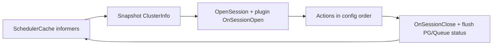

# Volcano scheduler architecture (audit map)

Source: `volcano-sh/volcano` @ shallow `master` clone (`/agent/repos/volcano`), Nov 2026.

## End-to-end scheduling cycle

| Step | Location | Notes |
|------|----------|--------|
| Tick | `pkg/scheduler/scheduler.go` `runOnce` | One session per period; fairshare assumes no overlap (`fairshare.go`) |
| Snapshot | `pkg/scheduler/cache/cache.go` `Snapshot` | Only **Ready** nodes; jobs without PodGroup skipped |
| Session | `pkg/scheduler/framework/session.go` `openSession` | Clones maps; `TotalResource` = sum of node allocatable |
| Plugins | `pkg/scheduler/framework/framework.go` | Tier-ordered `OnSessionOpen` registers extension fns on session |
| Actions | `pkg/scheduler/actions/*` | Default in docs: `enqueue, allocate, backfill`; optional `reclaim`, `preempt`, `gangreclaim`, `gangpreempt` |
| Statement | `pkg/scheduler/framework/statement.go` | Speculative `Evict`/`Pipeline`/`Allocate`; `Commit` → cache bind/evict |
| Close | `session.go` `closeSession` | PodGroup phase/status, queue allocated metrics |

## Scheduler framework and sessions

- **`Session`**: mutable per-cycle view (`Jobs`, `Nodes`, `Queues`, hypernodes, plugin fn maps, `PodGroupOldState`, `DirtyJobs`).
- **`Statement`**: transaction log; `Discard` LIFO-undoes session mutations; `Commit` pushes evictions/bindings to cache.
- **`SaveOperations` / `RecoverOperations`**: replays dry-run plans (topology-aware allocate, gang preemption/reclaim nominations).
- **Multi-plugin voting** (`session_plugins.go`): `JobReady` is conjunctive; `JobPipelined`/`JobEnqueueable` use permit/reject tiers; default pipelined **permissive** if no plugin votes.

## Actions

| Action | Package | Role |
|--------|---------|------|
| `enqueue` | `enqueue/` | Pending PG → `PodGroupInqueue` when `JobEnqueueable` |
| `allocate` | `allocate/` | Main placement; `Statement` + commit if `JobReady`/`JobPipelined` |
| `backfill` | `backfill/` | Best-effort pending tasks **without** resource requests; direct `ssn.Allocate` |
| `reclaim` | `reclaim/` | Cross-queue reclaim; commit iff pipelined |
| `preempt` | `preempt/` | Task-level preemption |
| `gangreclaim` / `gangpreempt` | `gangreclaim/`, `gangpreempt/` | Bundle-aware eviction + `RecoverOperations` plans |
| `shuffle` | `shuffle/` | Reshuffle (separate registration) |

Shared allocate pipeline (from `allocate.go`): queue order → job order → task order → predicates → node score → bind/speculate.

## Scheduling cache

- Informer-backed `SchedulerCache` (`cache/cache.go`): jobs, nodes, queues, bind pipeline, sharding.
- `OnSessionOpen` / `OnSessionClose` gate shard coordinator (`IsSessionRunning`).
- Consistency boundary: actions read **snapshot** at session open, not live maps.

## API model (`pkg/scheduler/api/`)

| Type | Responsibility |
|------|----------------|
| `TaskInfo` / `JobInfo` | Status index, gang helpers (`MinAvailable`, `IsReady`, `IsStarving`, elastic) |
| `NodeInfo` | `Idle`, `Used`, `Releasing`, `Pipelined`; `FutureIdle = Idle + Releasing - Pipelined` |
| `Resource` | Per-dimension float math; dominant share helpers |
| `QueueInfo` | Queue CR wrapper |

## Quota / gang plugins

| Plugin | Key hooks |
|--------|-----------|
| `gang` | `JobValid`, `JobReady`, `JobPipelined`, victim filtering vs `MinAvailable` |
| `proportion` | Weighted `deserved`, `share` (max dimension), `Overused`, reclaim victims |
| `capacity` | Hierarchical queue tree, ancestors, DRA, `UnifiedEvictableFn` |
| `fairshare` | Namespace decayed usage; optional enqueue gate |
| `drf` | Per-job dominant share; preempt/reclaim victim ordering |

## Controllers (`pkg/controllers/`)

- **podgroup**: creates/syncs PodGroups for volcano-scheduled pods.
- **job**: Volcano Job state machine, pod creation, framework plugins (MPI/PyTorch/…).
- **queue** / **namespacequeue**: queue lifecycle CRs.

## Admission (`pkg/webhooks/`)

Validate/mutate Jobs, Pods, PodGroups, Queues, etc. before objects reach informers.

## Tests and simulation

| Area | Paths |
|------|--------|
| Unit | `pkg/scheduler/**/*_test.go` (133+ scheduler tests) |
| Framework | `statement_test.go`, `statement_recover_test.go`, `session_plugins_test.go` |
| Actions | `allocate/placement_test.go`, `gangpreempt_test.go`, dry-run placement |
| E2E | `test/e2e/jobseq`, `gangevict`, `hypernode`, stress queues |
| Helpers | `pkg/scheduler/uthelper`, `actions/utils/simulate.go` |